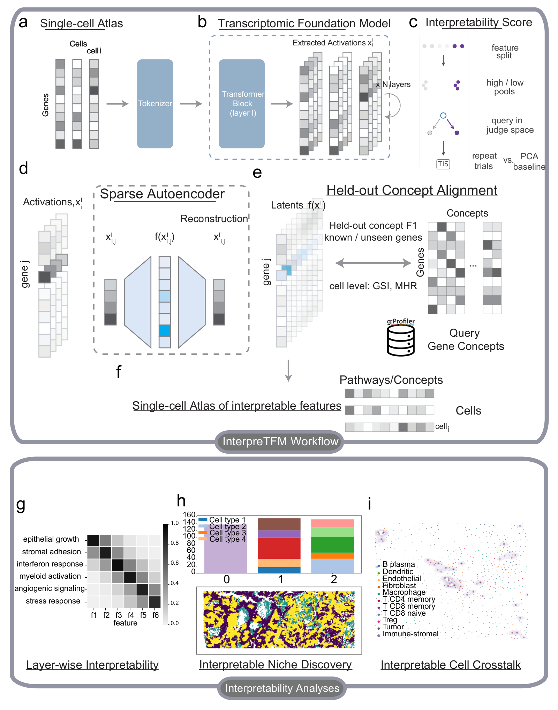

# interpreTFM

Layer-resolved evaluation of transcriptomic foundation models with sparse autoencoders.

[](https://interpretfm.readthedocs.io/en/latest/)
[](https://github.com/OliiverHu/interpreTFM/actions/workflows/ci.yml)
[](LICENSE)
[](pyproject.toml)

<p align="center">
  
</p>

**Figure 1.** The interpreTFM workflow: expression profiles are tokenized for a frozen foundation model (a, b), layer activations are scored with the transcriptomic interpretability score (c) and decomposed by a sparse autoencoder (d), features are evaluated by held-out concept alignment and cell-level specificity (e) and projected to cells (f), and the resulting profiles support layer-wise comparison, niche discovery and interface analysis (g–i).

## Overview

interpreTFM is a layer-resolved framework for evaluating what transcriptomic foundation models (scGPT, Geneformer and C2S-Scale) encode, using sparse autoencoders (SAEs), on single-cell and targeted spatial transcriptomic data.
Hidden states are extracted from the frozen models layer by layer, and each evaluated layer is decomposed by its own SAE.
The transcriptomic interpretability score (TIS) asks whether variation along a representation dimension is reflected in the measured transcriptome.
Held-out concept alignment scores features against biological concepts observable on the measured gene panel, with two held-out units (gene-token rows and whole genes), and compares them with raw hidden dimensions and an untrained SAE of the same width.
At the cell level, population specificity (GSI and MHR@100) is compared with that of single genes.
In spatial data, niches built from the features are compared with expression-only baselines, cell-group interfaces are tested with a calibrated statistic and checked for transcript spillover, and a model-free ligand–receptor co-localization screen places candidate pairs in tissue context.
Every measure is meant to be read next to its baseline, so that a feature-level result can be compared with what raw representations or measured expression already provide.

## Repository status

- This is a pre-release (0.9.0). It contains the `interp_pipeline` package used for the manuscript's analyses: model adapters and layer-resolved activation extraction, the sharded activation store, TIS, SAE helpers, held-out concept alignment, cell-level feature tables, and niche and interface building blocks.
- Several steps of the manuscript run from drivers that are not part of this pre-release: building the gene × concept matrix, the SAE trainer with the fixed ℓ1-weight rule and its untrained control, gene-token projection of features to cells, population specificity, the calibrated interface statistic with spillover checks, and the co-localization screen. The [concepts page](https://interpretfm.readthedocs.io/en/latest/concepts.html) states, for each measure, what 0.9 provides.
- A v1.0 pipeline with a single entry point, per-model containers, a Hugging Face release of trained SAEs, and a tutorial is in preparation for the final publication. See the [roadmap](https://interpretfm.readthedocs.io/en/latest/roadmap.html).

## Installation

The three foundation models need conflicting software stacks, so each has its own conda environment (Linux x86-64; exported from working CUDA 12 installations):

| Environment | Use | File |
|---|---|---|
| `interpretfm` | analysis, SAE training and evaluation, scGPT extraction | `envs/interpretfm.yml` |
| `geneformer` | Geneformer extraction | `envs/geneformer.yml` |
| `c2s` | C2S-Scale extraction | `envs/c2s.yml` |

```bash
git clone https://github.com/OliiverHu/interpreTFM.git
cd interpreTFM
conda env create -f envs/interpretfm.yml
conda activate interpretfm
python -m pip install -e .
```

The package is tested on Python 3.8, 3.9, 3.10 and 3.11 (continuous integration, CPU).
Install in editable mode (`-e`): some modules import plotting helpers from `plot/` at the repository root.
Without conda, install PyTorch for your platform first, then `python -m pip install -e ".[models]"`.
Model weights, datasets and activation stores are not distributed with the code; see the [installation guide](https://interpretfm.readthedocs.io/en/latest/installation.html).

## Quick start

In 0.9 the stages run as modules with `python -m`. The commands and snippets below are exercised on toy data by `tests/test_smoke.py`.

Plan the all-layer SAE, QC and held-out F1 jobs for your activation stores (edit the paths in the example first). `--status-only` writes a job manifest and a status table and runs nothing:

```bash
python -m interp_pipeline.layer_experiments.all_layer_sae_f1 --help
python -m interp_pipeline.layer_experiments.all_layer_sae_f1 \
    --model-spec-json configs/model_specs.example.json \
    --out-root runs/demo --status-only
```

Held-out concept alignment of one layer, from Python:

```python
from interp_pipeline.get_annotation.f1_alignment import heldout_report_for_layer

heldout_report_for_layer(
    layer="layer_1.norm2",
    store_root="/path/to/activation_stores/scgpt",  # <store_root>/activations/<layer>/shard_*/
    gt_csv="/path/to/gene_by_concept.csv",          # binary gene x concept matrix
    sae_ckpt_path="/path/to/sae.pt",
    out_dir="runs/f1/scgpt/layer_1.norm2/row_split",
    latent_thresholds=[0.0, 0.15, 0.3, 0.6],
    valid_frac=0.2,
    test_frac=0.1,
    heldout_unit="gene_token_row",                  # "gene_identity" holds out whole genes
    device="cpu",
    # scGPT stores keep vocabulary ids: also pass adata_path=... and scgpt_ckpt=...
)
```

TIS of one layer, with the shuffled-activation control:

```python
import anndata as ad
from interp_pipeline.tis.core import TISConfig, compute_tis_mis_quantile_streamed, shuffle_activations
from interp_pipeline.tis.io import build_judge_matrix, extract_cls_from_shards_aligned

adata = ad.read_h5ad("/path/to/section.h5ad")
A, has_row = extract_cls_from_shards_aligned(
    "/path/to/activation_stores/scgpt/activations/layer_1.norm2", obs_names=adata.obs_names
)
J = build_judge_matrix(adata[has_row], mode="log1p_cp10k")
cfg = TISConfig(K=32, n_trials=800, seed=42)
tis = compute_tis_mis_quantile_streamed(A[has_row], J, q_low=0.25, q_high=0.75, cfg=cfg)
tis_null = compute_tis_mis_quantile_streamed(shuffle_activations(A[has_row]), J, 0.25, 0.75, cfg)
```

Not yet available in 0.9: the `sae` and `qc` stages of `all_layer_sae_f1` and the TIS layer screen (`interp_pipeline.tis.single_layer_screen`) load backend modules through `--train-script`, `--qc-script` and `--backend-script` that are not part of this pre-release. These options have no default; a run that needs one stops with a message saying which option is missing (`--status-only` and `--dry-run` work without them). The backends come in v1.0, together with a single command that runs all stages from one configuration file.

## Repository layout

```text
src/interp_pipeline/    analysis package
  adapters/             model and dataset adapters (scGPT, Geneformer, C2S-Scale; AnnData)
  extraction/           layer-resolved activation extraction into sharded stores
  io/                   activation store and plotting style
  tis/                  transcriptomic interpretability score
  sae/                  sparse autoencoder model, trainer and checkpoint normalization
  get_annotation/       concept universe (g:Profiler) and held-out concept alignment
  layer_experiments/    all-layer SAE / QC / F1 runner and result aggregation
  downstream/           cell-level feature tables, niche discovery and interface scoring
  vendor/               adapted third-party model helpers (scGPT, cell2sentence)
plot/                   plotting helpers imported by the package (not in the wheel; use an editable install)
configs/                example configuration
envs/                   conda environment files
tests/                  unit and smoke tests (CPU, no data needed)
docs/                   documentation sources (Read the Docs)
```

## Documentation

Documentation is published at <https://interpretfm.readthedocs.io> (placeholder URL until the Read the Docs project is created). It covers installation, the measures, data formats, usage, evaluation best practices, the roadmap and the API reference. To build it locally:

```bash
python -m pip install -r docs/requirements.txt
sphinx-build -b html docs docs/_build/html
```

## Citation

The manuscript describing interpreTFM is in preparation. Until it is published, please cite the software ([`CITATION.cff`](CITATION.cff); GitHub's "Cite this repository" uses it):

```bibtex
@software{interpretfm,
  author  = {Hu, Yunfei},
  title   = {{interpreTFM}: layer-resolved evaluation of transcriptomic foundation models},
  version = {0.9.0},
  year    = {2026},
  url     = {https://github.com/OliiverHu/interpreTFM},
  note    = {Manuscript in preparation}
}
```

## License

interpreTFM is released under the GNU General Public License v3.0 or later ([`LICENSE`](LICENSE)). Adapted third-party code keeps its original license; see [`THIRD_PARTY_NOTICES.md`](THIRD_PARTY_NOTICES.md).

## Contact

Please use [GitHub issues](https://github.com/OliiverHu/interpreTFM/issues) for questions and bug reports, and see [`CONTRIBUTING.md`](CONTRIBUTING.md) for contributions.

## Acknowledgements

interpreTFM builds on scGPT, Geneformer, C2S-Scale and cell2sentence, g:Profiler, and the scverse ecosystem; we thank their developers.
